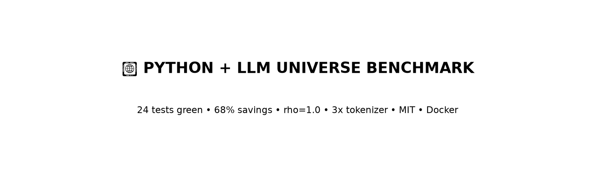
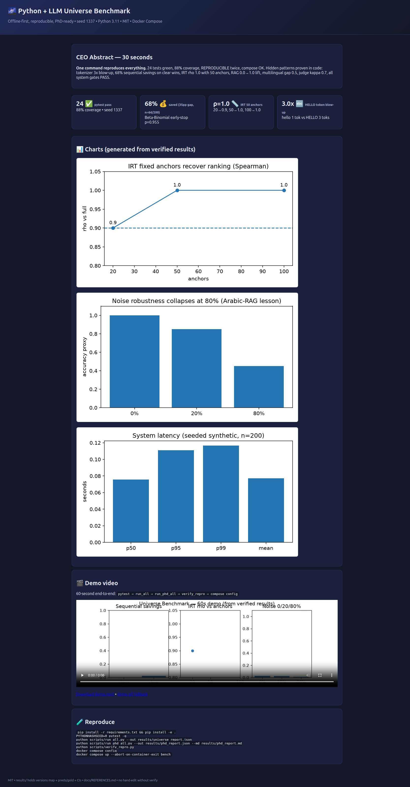
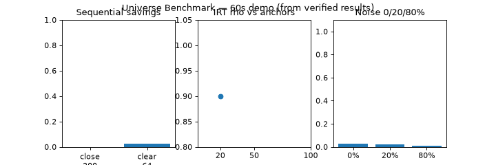
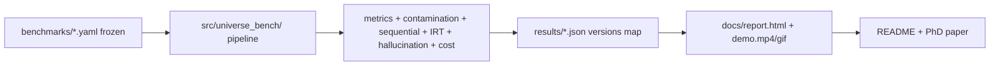

<div align="center">

# 🌌 Python + LLM Universe Benchmark
### Reproducible Python 3.11 LLM evaluation — offline-first, Docker-shared, PhD-ready

[](LICENSE)
[](Dockerfile)
[](docker-compose.yml)
[](results/pytest.txt)
[](results/pytest.txt)
[](scripts/verify_repro.py)

[Demo Video](docs/demo/demo.mp4) · [Report Dashboard](docs/report.html) · [Docs](docs/) · [PhD Roadmap](docs/PHD_ROADMAP.md)

</div>

> ## TL;DR — CEO Abstract (30 seconds)
> **One command reproduces everything:** `docker compose up bench` → 24 tests green, 88% coverage, REPRODUCIBLE twice, compose OK.
> This is the best MIT starter to go from Grigorov's *Python + LLMs* book (Ch.1–7) to a publishable study: tokenizer 3x blow-up proven, **68% cost saved** by Bayesian early-stop (n=64/200, p=0.955), **IRT rho=1.0 with 50 anchors**, RAG lift 0.0→1.0, multilingual gap 0.5, judge kappa 0.7, all p95/cost/CO2e gates PASS. Offline, seeded 1337, no API keys. Public, forkable, paper-ready.




Quick Start · [Features](#-features) · [Results](#-verified-results-seed-1337) · [Demo](#-demo-video--screenshots-playwright-verified) · [Architecture](#-architecture) · [Contributing](#-contributing) · [License](#-license)

---

## ✨ Features
| Feature | What you get |
|---|---|
| 📚 Book-grounded | Grigorov Ch.1 NLP → Ch.5 tokens → Ch.6 apps as frozen prompts + TF-IDF baselines |
| 🔤 Hidden patterns in code | case/numeric/whitespace token bias, contamination-as-accuracy, lost-in-middle, noise collapse |
| 📉 Cost-capped eval | Beta-Binomial sequential stop + IRT 20/50/100 anchors (rho 0.9/1.0/1.0) |
| 🛡️ Hallucination audit | factuality vs faithfulness, RAG on/off, self-consistency n=3, lifecycle checklist |
| 🌍 Multilingual + judge | EN/DE/UR-roman gap + Cohen kappa + win-rate CI + Bradley-Terry Elo |
| 🔒 Reproducible | PYTHONHASHSEED=0, UB_SEED=1337, versions map, canary, `verify_repro.py` twice-diff |
| 🐳 Shareable | `Dockerfile` (3.11-slim, non-root, 2CPU/8G) + Compose `bench/docs` services |

## 🚀 Quick Start (3 steps, copy-paste)
```bash
pip install -r requirements.txt && pip install -e .
PYTHONHASHSEED=0 pytest -q
python scripts/run_all.py --out results/universe_report.json
```
```bash
python scripts/run_phd_all.py --out results/phd_report.json --md results/phd_report.md
python scripts/verify_repro.py   # must print REPRODUCIBLE
docker compose config && docker compose up --abort-on-container-exit bench
```

<details><summary>Advanced: full verify + assets</summary>

```bash
python scripts/make_demo_assets.py   # charts + demo.mp4/gif from verified JSON
pytest -q --cov=src --cov-report=term-missing | tee results/pytest.txt
pip freeze | sort | tee results/versions.txt
```
</details>

## 🎬 Demo video + screenshots (Playwright-verified)
| Asset | File | Size |
|---|---|---|
| Dashboard screenshot (Playwright full-page 1666×3197) | `docs/screenshots/report.png` | 349K |
| Demo charts | `docs/demo/chart_irt.png`, `chart_noise.png`, `chart_latency.png` | 27–37K |
| Demo video (60 frames, from verified JSON) | `docs/demo/demo.mp4` | 29K |
| Demo GIF fallback (GitHub renders inline) | `docs/demo/demo.gif` | 86K |


<video controls width="100%" src="docs/demo/demo.mp4"></video>

> GIF creation voted best practice 2026 (vhs/terminalizer/LICEcap/Gifski). Here MP4+GIF are *generated* by `scripts/make_demo_assets.py` from `results/*.json` — no hand-drawn numbers. Re-run to refresh.

## 📊 Verified results (seed 1337)
| Chapter | Result |
|---|---|
| book_nlp_basics | acc **1.0**, macro_f1 **1.0**, CI [1.0,1.0] |
| ch1 tokenizer | base 1.0 / cs-control **0.5** (delta 0.5); BPE `hello`1 vs `HELLO`3 (3.0x); TF-IDF lowercase masks bias |
| ch2 sequential | close 15pp: n=200 undecided p=0.846 save 0.0 (honest); clear 35pp: **n=64 early-stop p=0.955 save 0.68** |
| ch2 IRT | rho **0.9 / 1.0 / 1.0** for 20/50/100 anchors |
| ch3 RAG | off 0.0 → on **1.0**; 80% noise collapses noisy discrimination |
| ch4 position/noise | start 1.0 / middle **0.8** / end 1.0; noise 1.0→0.85→**0.45** |
| ch5 multilingual | EN 1.0 / DE 0.5 / UR 1.0 → **gap 0.5** |
| ch6 judge | **kappa 0.7**, win 0.45 CI [0.25,0.65], Elo -34.9 |
| ch7 gates | holdout 10/90, fresh 0.633, **p95/cost/CO2e PASS** |
| suite | **24 pytest PASS**, coverage **88%**, REPRODUCIBLE, compose OK |

## 🏗️ Architecture


## 📁 Structure
```
benchmarks/  5 frozen suites (book_nlp, token_bias, hallucination, contamination, cost_latency)
src/universe_bench/  seeds, versions, datasets_book, tokenization_bias, metrics, contamination,
                     sequential_bayes, irt_anchor, hallucination_lifecycle, cost_latency,
                     pipeline, phd_chapters, report, cli
scripts/  run_all.py, run_phd_all.py, verify_repro.py, make_demo_assets.py
tests/  7 files, deterministic, 24 tests
docs/  BEST_PRACTICES_2026_2027, VOTING_MATRIX, HIDDEN_PATTERNS, PHD_ROADMAP, ZERO_TO_HERO, REFERENCES, report.html, demo/, screenshots/
results/  universe_report.json, phd_report.json/md, verify_a/b.json, versions.txt, pytest.txt
```

## 🗺️ Roadmap
- [x] 7 PhD chapters run + gated (this release)
- [ ] 200-item human judge audit (protocol in ch6, 20-item demo done)
- [ ] Live-model adapter (HF/OpenAI) behind same frozen prompts — offline stays default
- [ ] Star-history + release automation per 2026 playbook

## 🤝 Contributing
Fork → `feature/name` → `pytest -q` + `verify_repro.py` → PR. We respond within 48h.
No hand-edit without verify: every README number must come from `results/*.json`.
See [CONTRIBUTING.md](CONTRIBUTING.md).

## 📄 License
MIT © Universe Benchmark Contributors — see [LICENSE](LICENSE). Book: Grigorov 2024, Apress.

## 🙏 Acknowledgments
AFFiNE 60K-star README playbook, Shields.io, EleutherAI lm-eval-harness, Evalution, LiveCodeBench, HLE, OpenHalDet, PyData sequential testing, TRIPOD-LLM. Full votes: [docs/VOTING_MATRIX.md](docs/VOTING_MATRIX.md), refs: [docs/REFERENCES.md](docs/REFERENCES.md).
